# Modelo relacional final — Taller Ruta 27

**IC-4301 Bases de Datos I · Proyecto (2.ª entrega) · Grupo 02**

El modelo implementa **32 relaciones** en el esquema `taller` de PostgreSQL 17: 31 de negocio y 1 catálogo de transiciones. Parte del modelo lógico del Proyecto 1 (23 relaciones) y del Lab03 (6 tablas), con las correcciones D1–D12 documentadas en [`../Control_de_Cambios.md`](../Control_de_Cambios.md). La correspondencia relación por relación está en [`correspondencia_P1_actual.md`](correspondencia_P1_actual.md) y el detalle de cada atributo en [`diccionario_datos.md`](diccionario_datos.md).

## 1. Esquema relacional (notación textual)

Subrayado lógico: **PK**; `→` indica FK; `(a, b) →` indica una **FK compuesta de contexto**, que garantiza que la fila pertenece a la *misma* orden, labor o técnico que la referenciada.

### Maestros e identidad
```
CLIENTE(cliente_id PK, identificacion UQ, nombre_razon_social, tipo_cliente)
CONTACTO_CLIENTE(contacto_id PK, cliente_id → CLIENTE, tipo_contacto, valor_contacto, recibe_avisos)
                 UQ(cliente_id, tipo_contacto, valor_contacto)          -- ≥1 recibe_avisos por cliente (al COMMIT)
VEHICULO(vin PK, placa, marca, modelo, anio, tipo_combustible)
PROPIEDAD_VEHICULO(propiedad_id PK, vin → VEHICULO, cliente_id → CLIENTE, desde, hasta)
                   EXCLUDE(vin =, [desde, hasta) &&)
PERSONAL(personal_id PK, nombre, rol, activo)
ESPECIALIDAD_TECNICO(especialidad_id PK, tecnico_id → PERSONAL, especialidad, fecha_inicio, fecha_fin)
                     UQ(especialidad_id, tecnico_id); EXCLUDE(tecnico_id =, especialidad =, [inicio, fin] &&)
REPUESTO(repuesto_id PK, descripcion, marca, unidad_manejo)
PROVEEDOR(proveedor_id PK, nombre UQ, identificacion UQ)
PROVEEDOR_REPUESTO(proveedor_repuesto_id PK, proveedor_id → PROVEEDOR, repuesto_id → REPUESTO,
                   codigo_proveedor, precio_referencia)  UQ(proveedor_id, codigo_proveedor), UQ(proveedor_id, repuesto_id)
```

### Visita y recepción
```
ORDEN_TRABAJO(orden_id PK, vin → VEHICULO, placa_ingreso, cliente_factura_id → CLIENTE,
              entregado_por_cliente_id → CLIENTE, autorizador_cliente_id → CLIENTE, receptor_id → PERSONAL,
              fecha_hora_recepcion, kilometraje_ingreso, nivel_combustible, motivo_informado,
              observaciones_visibles, fecha_prometida_actual, estado_actual)
              UQ(orden_id, vin); UNIQUE parcial (vin) WHERE estado_actual no terminal
FACULTAD_ORDEN(facultad_id PK, orden_id → ORDEN_TRABAJO, cliente_id → CLIENTE, tipo_facultad, fuente,
               otorgada_por_cliente_id → CLIENTE, medio_verificacion, vigente_desde, vigente_hasta,
               registrada_por_id → PERSONAL)  UQ(facultad_id, orden_id);
               EXCLUDE(orden_id =, cliente_id =, tipo_facultad =, [desde, hasta) &&)
OBJETO_DANO(detalle_id PK, orden_id → ORDEN_TRABAJO, tipo_detalle, descripcion, confirmado_cliente)
HISTORIAL_ORDEN(historial_id PK, orden_id → ORDEN_TRABAJO, secuencia, estado_anterior, estado, fecha_hora,
                personal_id → PERSONAL, motivo, registrado_en)  UQ(orden_id, secuencia)
HISTORIAL_FECHA_PROMETIDA(cambio_fecha_id PK, orden_id → ORDEN_TRABAJO, secuencia, fecha_anterior, fecha_nueva,
                          fecha_hora_comunicacion, medio_comunicacion, motivo, personal_id → PERSONAL,
                          registrado_en)  UQ(orden_id, secuencia)
TRANSICION_ESTADO_ORDEN(estado_desde, estado_hacia PK, requiere_motivo, descripcion)
```

### Diagnóstico y presupuesto (G02-P01)
```
HALLAZGO(hallazgo_id PK, orden_id → ORDEN_TRABAJO, diagnosticado_por_id → PERSONAL, fecha_hora,
         sintoma_comprobado, posible_causa, urgencia, recomendacion)  UQ(hallazgo_id, orden_id)
PROPUESTA(propuesta_id PK, orden_id → ORDEN_TRABAJO, version, estado, (propuesta_base_id, orden_id) → PROPUESTA,
          presentada_por_id → PERSONAL, fecha_hora_presentacion, observacion, creada_en)
          UQ(orden_id, version), UQ(propuesta_id, orden_id)
LABOR(labor_id PK, orden_id → ORDEN_TRABAJO, (hallazgo_id, orden_id) → HALLAZGO, descripcion, es_emergencia,
      (labor_revisada_id, orden_id) → LABOR, (prueba_origen_id, labor_revisada_id) → PRUEBA,
      estado_labor, creada_por_id → PERSONAL, creada_en)  UQ(labor_id, orden_id)
LINEA_PROPUESTA((propuesta_id, labor_id) PK, (propuesta_id, orden_id) → PROPUESTA, (labor_id, orden_id) → LABOR,
                precio_estimado, alcance)  UQ(propuesta_id, labor_id, orden_id)
REPUESTO_PROPUESTO((propuesta_id, labor_id, repuesto_id) PK, (propuesta_id, labor_id) → LINEA_PROPUESTA,
                   repuesto_id → REPUESTO, cantidad_estimada, precio_unitario_estimado)
AUTORIZACION_LABOR(autorizacion_id PK, (propuesta_id, labor_id, orden_id) → LINEA_PROPUESTA,
                   (facultad_id, orden_id) → FACULTAD_ORDEN, cliente_id → CLIENTE, decision, fecha_hora, medio,
                   observacion, registrado_por_id → PERSONAL, registrado_en)  UQ(autorizacion_id, labor_id)
```

### Ejecución (G02-P02)
```
EXCEPCION_EMERGENCIA(emergencia_id PK, (labor_id, orden_id) → LABOR, riesgo, justificacion, alcance_minimo,
                     autorizada_por_id → PERSONAL, fecha_hora)  UQ(labor_id), UQ(emergencia_id, labor_id)
LABOR_DEPENDENCIA((labor_id, requiere_labor_id) PK, (labor_id, orden_id) → LABOR, (requiere_labor_id, orden_id) → LABOR)
HISTORIAL_LABOR(historial_labor_id PK, labor_id → LABOR, secuencia, estado_anterior, estado_nuevo, fecha_hora,
                personal_id → PERSONAL, (autorizacion_id, labor_id) → AUTORIZACION_LABOR,
                (emergencia_id, labor_id) → EXCEPCION_EMERGENCIA, motivo, registrado_en)  UQ(labor_id, secuencia)
PARTICIPACION_TECNICA(participacion_id PK, (labor_id, orden_id) → LABOR, tecnico_id → PERSONAL,
                      (especialidad_id, tecnico_id) → ESPECIALIDAD_TECNICO, inicio, fin, minutos_efectivos,
                      descripcion_participacion)  EXCLUDE(tecnico_id =, [inicio, fin) &&)
PRUEBA(prueba_id PK, (labor_id, orden_id) → LABOR, personal_id → PERSONAL, fecha_hora, tipo_prueba, resultado,
       medicion_valor, unidad, descripcion_resultado)  UQ(prueba_id, labor_id)
CONSUMO_REPUESTO(consumo_id PK, (labor_id, orden_id) → LABOR, repuesto_id → REPUESTO, cantidad_utilizada,
                 precio_unitario_cargado, fecha_hora, registrado_por_id → PERSONAL)  UQ(consumo_id, repuesto_id, orden_id)
MOVIMIENTO_INVENTARIO(movimiento_id PK, repuesto_id → REPUESTO, orden_id → ORDEN_TRABAJO, tipo_movimiento, cantidad,
                      fecha_hora, (consumo_id, repuesto_id, orden_id) → CONSUMO_REPUESTO, registrado_por_id → PERSONAL,
                      motivo)  UQ(consumo_id)
PIEZA_RETIRADA(pieza_retirada_id PK, (labor_id, orden_id) → LABOR, descripcion, destino, fecha_hora,
               registrado_por_id → PERSONAL)
```

### Entrega y garantía
```
ENTREGA(entrega_id PK, orden_id → ORDEN_TRABAJO UQ, retira_cliente_id → CLIENTE, (facultad_id, orden_id) → FACULTAD_ORDEN,
        entregado_por_id → PERSONAL, fecha_hora, kilometraje_salida, revision_final, recomendaciones_futuras,
        conformidad, observaciones)  UQ(entrega_id, orden_id)
GARANTIA(garantia_id PK, (entrega_id, orden_id) → ENTREGA, (labor_id, orden_id) → LABOR, dias, km, condiciones)
         UQ(entrega_id, labor_id)
RECLAMO_GARANTIA(reclamo_id PK, garantia_id → GARANTIA, orden_nueva_id → ORDEN_TRABAJO UQ, fecha_reclamo, km_reclamo,
                 evaluacion, decision, justificacion, evaluado_por_id → PERSONAL)
```

## 2. Diagrama entidad-relación (Mermaid)

Para que el diagrama se lea bien, se muestran las claves y los atributos que definen cada relación. Los atributos descriptivos completos están en el diccionario.

```mermaid
erDiagram
    CLIENTE ||--o{ CONTACTO_CLIENTE : "tiene"
    CLIENTE ||--o{ PROPIEDAD_VEHICULO : "es propietario"
    VEHICULO ||--o{ PROPIEDAD_VEHICULO : "pertenece"
    VEHICULO ||--o{ ORDEN_TRABAJO : "visita"
    CLIENTE ||--o{ ORDEN_TRABAJO : "factura / entrega / autoriza"
    PERSONAL ||--o{ ORDEN_TRABAJO : "recibe"
    ORDEN_TRABAJO ||--o{ FACULTAD_ORDEN : "faculta"
    CLIENTE ||--o{ FACULTAD_ORDEN : "facultado"
    ORDEN_TRABAJO ||--o{ OBJETO_DANO : "registra"
    ORDEN_TRABAJO ||--|{ HISTORIAL_ORDEN : "cambia de estado"
    TRANSICION_ESTADO_ORDEN ||..o{ HISTORIAL_ORDEN : "permite"
    ORDEN_TRABAJO ||--o{ HISTORIAL_FECHA_PROMETIDA : "promete"
    PERSONAL ||--o{ ESPECIALIDAD_TECNICO : "tiene"
    ORDEN_TRABAJO ||--o{ HALLAZGO : "diagnostica"
    PERSONAL ||--o{ HALLAZGO : "es autor"
    ORDEN_TRABAJO ||--o{ PROPUESTA : "versiona"
    PROPUESTA |o--o{ PROPUESTA : "amplía"
    ORDEN_TRABAJO ||--o{ LABOR : "contiene"
    HALLAZGO |o--o{ LABOR : "origina"
    LABOR |o--o{ LABOR : "retrabajo de"
    PROPUESTA ||--|{ LINEA_PROPUESTA : "ofrece"
    LABOR ||--o{ LINEA_PROPUESTA : "se cotiza en"
    LINEA_PROPUESTA ||--o{ REPUESTO_PROPUESTO : "estima"
    REPUESTO ||--o{ REPUESTO_PROPUESTO : "estimado"
    LINEA_PROPUESTA ||--o{ AUTORIZACION_LABOR : "se decide"
    FACULTAD_ORDEN ||--o{ AUTORIZACION_LABOR : "habilita decidir"
    LABOR ||--o| EXCEPCION_EMERGENCIA : "habilitada por"
    LABOR ||--o{ LABOR_DEPENDENCIA : "requiere"
    LABOR ||--|{ HISTORIAL_LABOR : "cambia de estado"
    AUTORIZACION_LABOR |o--o{ HISTORIAL_LABOR : "habilita"
    EXCEPCION_EMERGENCIA |o--o{ HISTORIAL_LABOR : "habilita"
    LABOR ||--o{ PARTICIPACION_TECNICA : "ejecutada por"
    PERSONAL ||--o{ PARTICIPACION_TECNICA : "participa"
    ESPECIALIDAD_TECNICO |o--o{ PARTICIPACION_TECNICA : "con"
    LABOR ||--o{ PRUEBA : "se prueba"
    PRUEBA |o--o{ LABOR : "origina retrabajo"
    LABOR ||--o{ CONSUMO_REPUESTO : "consume"
    REPUESTO ||--o{ CONSUMO_REPUESTO : "consumido"
    CONSUMO_REPUESTO ||--|| MOVIMIENTO_INVENTARIO : "genera"
    REPUESTO ||--o{ MOVIMIENTO_INVENTARIO : "se mueve"
    LABOR ||--o{ PIEZA_RETIRADA : "retira"
    PROVEEDOR ||--o{ PROVEEDOR_REPUESTO : "ofrece"
    REPUESTO ||--o{ PROVEEDOR_REPUESTO : "se compra a"
    ORDEN_TRABAJO ||--o| ENTREGA : "se entrega"
    FACULTAD_ORDEN ||--o{ ENTREGA : "habilita retirar"
    ENTREGA ||--o{ GARANTIA : "otorga"
    LABOR ||--o{ GARANTIA : "garantizada"
    GARANTIA ||--o{ RECLAMO_GARANTIA : "reclamada"
    ORDEN_TRABAJO ||--o| RECLAMO_GARANTIA : "abre (orden nueva)"

    ORDEN_TRABAJO {
        integer orden_id PK
        varchar vin FK
        varchar placa_ingreso
        integer cliente_factura_id FK
        integer autorizador_cliente_id FK
        timestamptz fecha_hora_recepcion
        d_estado_orden estado_actual "solo vía historial"
        timestamptz fecha_prometida_actual "solo vía historial"
    }
    FACULTAD_ORDEN {
        bigint facultad_id PK
        integer orden_id FK
        integer cliente_id FK
        varchar tipo_facultad "Aprobar | Retirar"
        varchar fuente "Titular | Designación | Representación legal"
        timestamptz vigente_desde
        timestamptz vigente_hasta
    }
    PROPUESTA {
        bigint propuesta_id PK
        integer orden_id FK
        integer version "UQ con orden"
        varchar estado "Borrador | Presentada"
    }
    LABOR {
        bigint labor_id PK
        integer orden_id FK
        integer hallazgo_id FK
        bool es_emergencia
        bigint labor_revisada_id FK
        bigint prueba_origen_id FK
        d_estado_labor estado_labor "solo vía historial"
    }
    LINEA_PROPUESTA {
        bigint propuesta_id PK
        bigint labor_id PK
        numeric precio_estimado
        text alcance
    }
    AUTORIZACION_LABOR {
        bigint autorizacion_id PK
        bigint propuesta_id FK
        bigint labor_id FK
        bigint facultad_id FK
        varchar decision "Aceptada | Rechazada | Pendiente"
        timestamptz fecha_hora
    }
    HISTORIAL_LABOR {
        bigint historial_labor_id PK
        bigint labor_id FK
        integer secuencia
        d_estado_labor estado_nuevo
        bigint autorizacion_id FK
        bigint emergencia_id FK
    }
    MOVIMIENTO_INVENTARIO {
        bigint movimiento_id PK
        varchar repuesto_id FK
        varchar tipo_movimiento
        numeric cantidad "> 0; el signo lo da el tipo"
        bigint consumo_id FK "obligatorio si es Consumo"
    }
    GARANTIA {
        bigint garantia_id PK
        bigint entrega_id FK
        bigint labor_id FK
        integer dias
        integer km
    }
    RECLAMO_GARANTIA {
        bigint reclamo_id PK
        bigint garantia_id FK
        integer orden_nueva_id FK "UQ, mismo VIN"
        varchar decision
    }
```



## 3. Decisiones de diseño físico más importantes

| Decisión | Motivo |
|---|---|
| **FK compuestas de contexto** (`(x_id, orden_id) → padre(x_id, orden_id)` contra un `UNIQUE` del padre) | Demuestran **pertenencia**, no solo existencia: una labor, hallazgo, facultad, propuesta, prueba o emergencia de *otra* orden o labor se rechaza aunque el id exista. Sin el trigger, la FK sigue rechazando (lo prueban `G02-P01-I-01`, `G02-P01-I-02`, `G02-P02-I-01` y `G02-P02-L-02`). |
| **Labor separada de su línea por versión** (`labor` + `linea_propuesta`) | Permite comparar la misma labor entre versiones con distinto precio (D6) y que la decisión sea por versión (regla de decisión aplicable). |
| **Valor actual + historial** (estado y promesa de la orden; estado de la labor) | Lectura rápida del valor vigente sin perder la historia. Solo cambia desde el `AFTER INSERT` del historial, en la misma transacción. Un `UPDATE` directo se rechaza y un constraint trigger diferido verifica la coherencia al `COMMIT` (D4). |
| **`secuencia` asignada bajo bloqueo** | Da un orden inequívoco a los cambios del mismo instante, sin depender de `fecha_hora`. |
| **Tablas históricas de solo inserción** | Un trigger `BEFORE UPDATE OR DELETE` lanza `G02-INM` (historiales, autorizaciones, emergencias, pruebas, consumos, movimientos, entregas, garantías, dependencias y piezas retiradas). |
| **`EXCLUDE USING gist`** (`btree_gist`) | Garantiza de forma declarativa que no haya traslapes en: propiedad del vehículo, especialidades, facultades vigentes y participaciones de un mismo técnico. |
| **Existencias derivadas** (`v_existencias`) | El stock no se guarda: se calcula desde los movimientos. El trigger de inventario bloquea la fila del repuesto y rechaza saldos físicos o disponibles negativos. |
| **Índice único parcial** `uq_orden_abierta_por_vehiculo` | Un vehículo no puede estar en dos visitas abiertas a la vez (RN-01). |
| **IDENTITY BY DEFAULT** e `integer` en las relaciones heredadas del Lab03 | Permite reutilizar sin modificación el alta `sp_registrar_orden(INTEGER, …)` y cargar IDs fijos legibles. |
